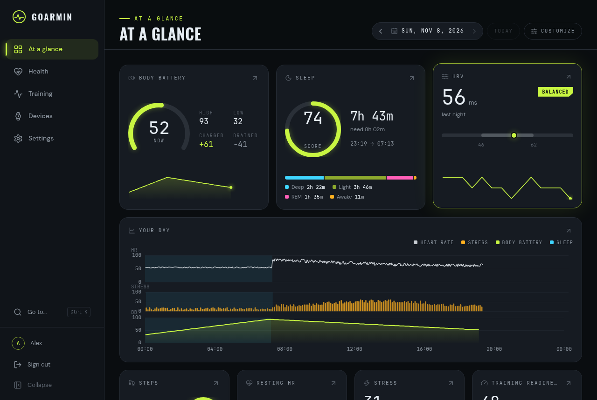
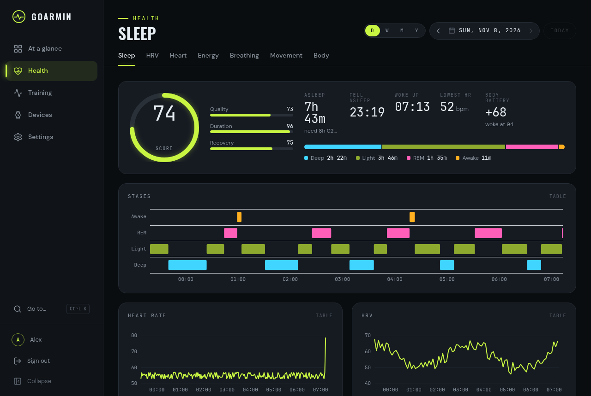
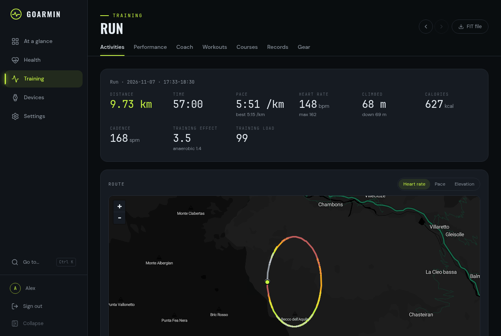
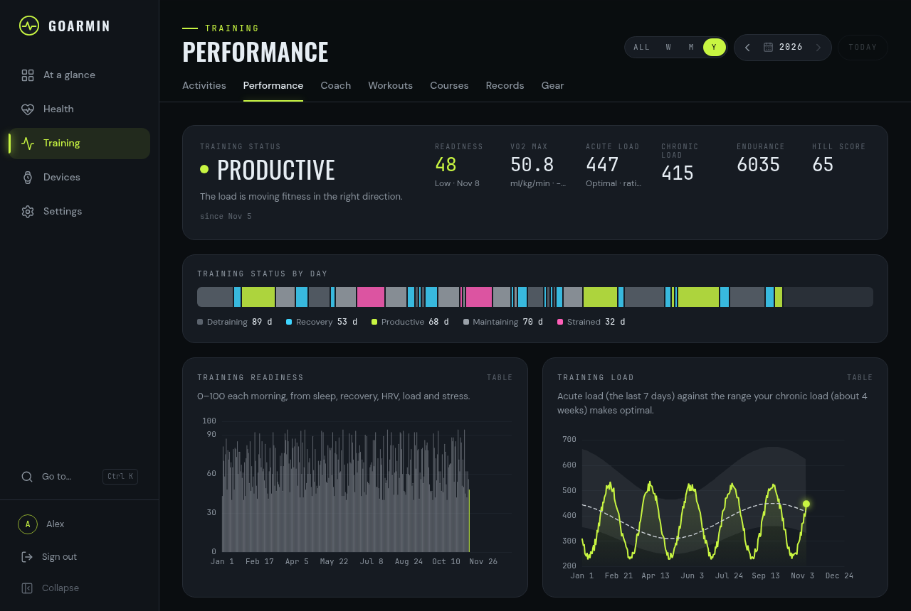
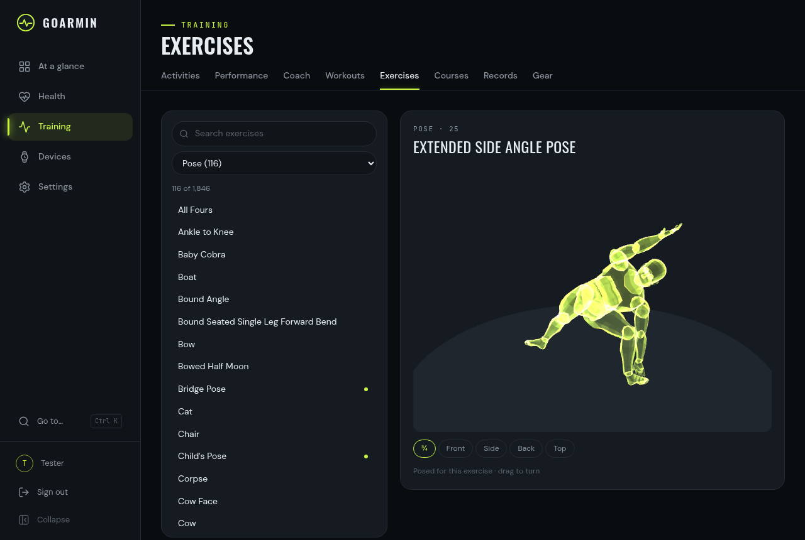

# goarmin

A self-hosted replacement for Garmin Connect. goarmin syncs your Garmin watch over Bluetooth on
Linux, imports your history from the watch on USB and from Garmin's data export, and keeps
everything on your own machine. It shows it all in a web dashboard, with an account for each
person in the household. No Garmin account, phone or cloud is needed.



## What it does

- **Sync.** Add a watch from the browser (a pairing wizard with the watch's code). goarmin syncs
  it every 30 minutes and on request. For each watch you choose whether files stay on it for
  another app, or are marked as synced as Garmin Connect does.
- **Health.** Each by day, week, month and year:
  - sleep with stages, scores and naps;
  - HRV against its baseline, and Garmin's health status;
  - heart rate with ECG recordings;
  - stress and Body Battery, breathing, movement;
  - body: weigh-ins from a scale, skin temperature, hydration, fitness age.
- **Training.**
  - Activities with a map, linked charts, laps, splits and time in zones.
  - Performance over the years: VO2 max, training status, readiness, load, race predictions,
    endurance, hill score.
  - Garmin Coach's plan, a workout library (the watch's and Garmin Connect's workouts, and which
    are on each watch), courses, personal records, gear.
- **Calendar.** Every day with bars for what was recorded, a day view with its timeline and
  values, Garmin Coach's plan and your own planned workouts, ticked off when done.
  - A 3D figure for every exercise a workout can name (1,846): View pose on a workout's steps,
    and a searchable catalogue under Training › Exercises.
- **Live.** Heart rate, stress, Body Battery, breathing, steps, calories and floors as the watch
  measures them.
- **Devices.** Watches, scales and every other device you had:
  - battery, the sync log, the files each brought, and an inspector that names every field of
    any FIT file;
  - unpair a watch, hand it over to another account, or delete its data.
- **Import.** The Garmin Connect export (years of history in about a minute), a watch plugged in
  by USB (read-only, automatic), or any FIT files, folders and zips.
- **At a glance.** A board of cards you arrange yourself.
- **Accounts.** Passkeys or passwords, by invitation. Everyone sees only their own data; admins
  don't see other people's health data either.

| | |
|---|---|
|  |  |
|  |  |

*Screenshots show made-up data.*

## Privacy

- Your data stays in one directory (`~/.local/share/goarmin`): a SQLite database and the raw
  files, from which everything else can be rebuilt.
- The dashboard loads everything from goarmin itself and makes no requests to third parties.
- goarmin's only outside requests are for map tiles, and only if you configure a tile server.
- When the watch asks for its position, goarmin answers that location services are off.

## Quick start

On a Linux computer with Bluetooth, near the watch:

```sh
git clone https://github.com/karamble/goarmin.git && cd goarmin
make web-deps    # once: the dashboard's npm packages
make start       # build and start on http://localhost:8642
make logs        # the first start prints the link that creates your account
```

Then **Devices › Add a watch**, and **Devices › Import** for your Garmin Connect export. The
full walk-through is [docs/getting-started.md](docs/getting-started.md).

**In Docker:** `docker/` runs the server in a container, on a private network or behind a reverse proxy with HTTPS. See
[docker/README.md](docker/README.md). The sync role stays on the computer the watch is paired
with.

## Supported watches

goarmin is developed and tested with a **Garmin Fenix 8** on BlueZ 5.87. Other recent Garmin
watches that sync the same way (Garmin's FileAccess sync) are likely to work but are untested.
Reports are welcome. Imports read FIT files from any Garmin device, so older watches and
scales show up through the export.

## Documentation

| | |
|---|---|
| [Getting started](docs/getting-started.md) | Install, first account, add your watch, import your history |
| [User guide](docs/user-guide.md) | The dashboard, page by page |
| [Running goarmin](docs/running.md) | One computer or a server, Docker, HTTPS, backups, updates, settings |
| [Architecture](docs/architecture.md) | How the sync, imports and storage work |
| [The data](docs/data.md) | What goarmin reads from FIT files and the export, and which source wins |
| [Development](docs/development.md) | Build, test, change the code |
| [API](docs/api.md) | The HTTP API |
| [Protocol notes](docs/protocol/README.md) | How a Garmin watch talks over Bluetooth |

## Status

goarmin is young and used daily by its author. The server can run anywhere (Docker) while a
**sync node** on the computer near the watch syncs it and hands the files over
(`make node-start`). Planned next are adding new watches through a sync node, a workout builder,
and an optional bridge to Garmin for satellite data and firmware.

goarmin was written from scratch. Gadgetbridge's open-source Garmin support and a capture of
Garmin Connect served as protocol references; none of Gadgetbridge's code is in goarmin.

Garmin, Fenix and Garmin Connect are trademarks of Garmin Ltd. goarmin is not affiliated with
or endorsed by Garmin.

## License

ISC, see [LICENSE](LICENSE).

The exercise figures use a body from Blender Studio's *Human Base Meshes* (CC0) and are drawn
with three.js (MIT). Security issues: see [SECURITY.md](SECURITY.md).

## Disclaimer

**Use at your own risk.** goarmin is provided "as is", without warranty of any kind, express or
implied. The authors and contributors accept no liability for any damage or loss arising from its
use or from the inability to use it, including inaccurate, incomplete or lost data.

**No medical advice.** goarmin is not a medical device. It shows what your devices recorded, as it
reads their files; the accuracy and completeness of the data and of the values derived from it
are not guaranteed. Do not base medical, health or training decisions on it; consult a physician.

**Exercise figures.** The exercise figures are simplified visualizations of each movement, without
equipment. This visualization is for illustrative purposes only; accuracy is not guaranteed.
Please consult a professional instructor. Exercise at your own risk.
