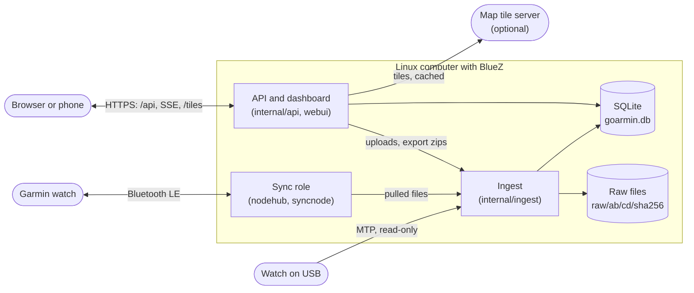
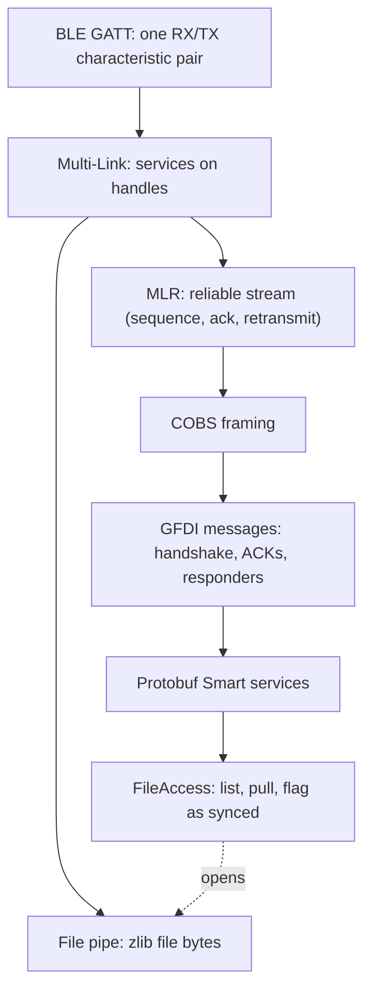
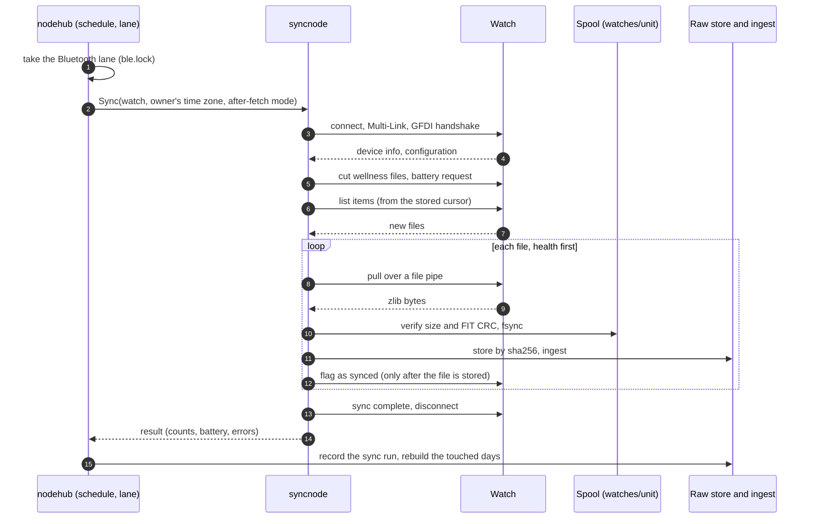
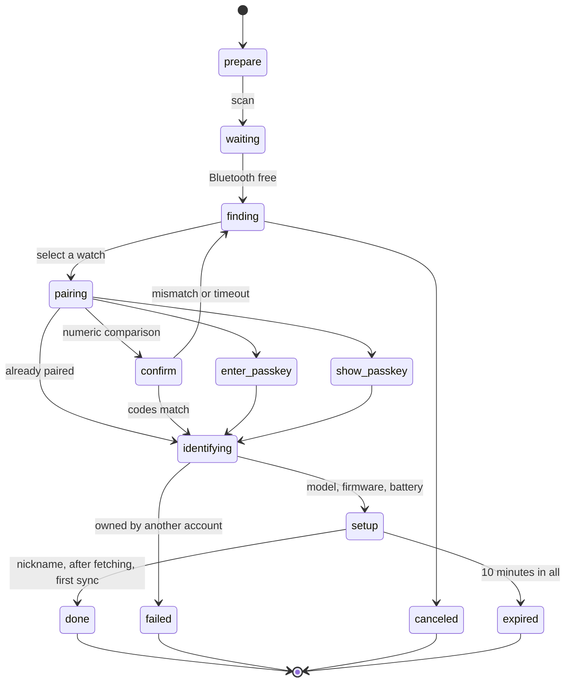
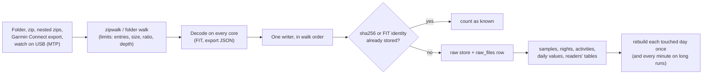
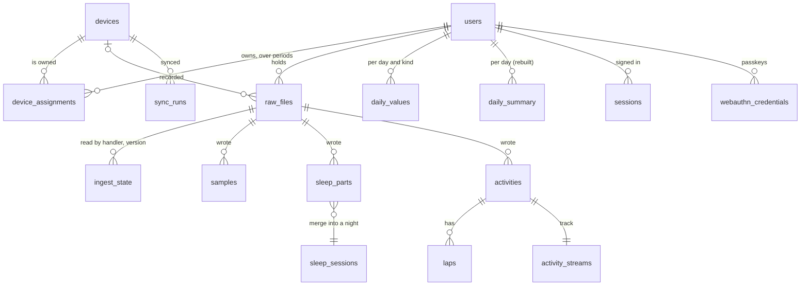
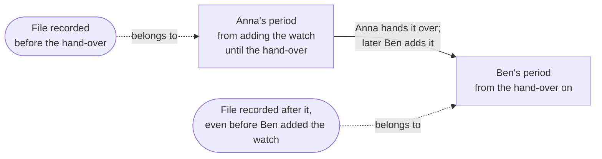

# Architecture

How goarmin is put together: its roles, how a sync and an import travel through it, how it
stores data, and how the API and the dashboard sit on top. For running it see
[running.md](running.md); for the data it reads see [data.md](data.md).

## One binary, several roles

`goarmin` is one Go program (no cgo). Its subcommands are the roles:

| Role | Command | What it does |
|---|---|---|
| Server | `goarmin serve` | The API, the SQLite database, the raw file store, imports, and the dashboard (embedded) |
| Sync role | `goarmin serve -with-sync` | The server plus the Bluetooth side: syncs this computer's watches on a schedule, streams live values, pairs new watches |
| Tools | `pair`, `sync`, `probe`, `live`, `import`, `usb`, `reingest`, `backup`, `user`, `days`, `activities`, `healthcheck` | One-off work on the same data directory |

The sync role needs the computer the watch is paired with: Bluetooth bonds live in BlueZ on
that machine. The server alone can run anywhere, for example in a container
([docker/README.md](../docker/README.md)). A separate sync node that uploads to a remote server
is planned (milestone M7); until then the server and the sync role run in one process.

## Code layout

- `cmd/goarmin`: the subcommands.
- `pkg/`: reusable packages with no goarmin knowledge.
  - `bluez`: BlueZ over D-Bus (discovery, pairing agent, GATT).
  - `garmin/...`: the watch protocol, bottom up:
    - `multilink`, `gfdi`, `smart` (protobuf);
    - `watch` (connect and handshake), `fileaccess` (list, pull, archive), `realtime`;
    - `wellness` and `gcexport` (readers);
    - `product`;
    - `fakewatch`, a watch in a test.
  - FIT: `fitid`, `fitactivity`, `fitwatch`, `fitnamed`, `fitprofile`.
  - Storage and files: `sqlitex`, `blobstore`, `zipwalk`, `mtp`.
  - Small helpers: `btsnoop`, `cobs`, `clock`, `httpx`, `auth`, `geo`.
- `internal/`: the application.
  - `store` holds the database and its queries.
  - `ingest` turns files into rows.
  - `importer` runs imports and the USB watcher.
  - `nodehub` is the sync role: schedule, Bluetooth lane, live links, pairing sessions.
  - `syncnode` is one sync, plus the spool.
  - `api` serves HTTP; `webui` is the embedded dashboard.
  - `tiles` mounts the tile cache; `backup` writes archives; `usbsource` finds watches on USB;
    `config` reads settings.
- `web/` is the dashboard source (React).
- `tools/` holds developer tools.

## The sync

A sync is one Bluetooth connection: connect, handshake, list what is new, pull it, store it,
then tell the watch it may let go of it. The protocol is documented layer by layer in
[docs/protocol](protocol/README.md); what goarmin does on the real Fenix 8 is in
[06-linux-live.md](protocol/06-linux-live.md).

- **Only after a durable store.** A file is flagged as synced only once it is in the raw
  store. A flag lets the watch delete health files, so a crash between pull and store loses
  nothing: the next sync pulls the file again.
- **After fetching** is a per-watch setting:
  - `keep` never flags, so another app can still sync the files;
  - `archive` flags like Garmin Connect;
  - `archive_delete` also deletes activities from the watch.
- **Schedule.** Every 30 minutes by default. A sync that finds the watch out of range backs off
  (1 to 30 minutes) and doesn't count as a failure. One Bluetooth operation runs at a time (the
  lane): a scheduled sync, a requested one, a live link, a pairing session, or a CLI command
  holding `ble.lock`.
- **Live values.** Opened on demand. Heart rate, stress, Body Battery, respiration, steps,
  calories and floors stream to every viewer over Server-Sent Events, with the last 10 minutes
  replayed. The link closes 30 seconds after the last viewer leaves, and after 30 minutes at
  most.
- **Pairing.** A server-side session that the browser follows over SSE. Ownership is decided
  before anything is saved: a watch that belongs to another account is refused without naming
  it.

## Imports

Files also arrive without Bluetooth:
- **Uploads** through the dashboard: FIT files, folders, zips, the Garmin Connect export.
- **A watch on USB:** read over MTP, read-only.
- **`goarmin import`** on the command line.

All of them go through the same path as a sync's files.

- **Raw files are the source of truth.** Every file is stored by content (`raw/ab/cd/<sha256>`)
  before anything is extracted, and `goarmin reingest` rebuilds every derived row from them.
- **Handlers have versions** (`fit` and `gcjson`). Bumping one re-reads only the files an older
  version read.
- **Duplicates collapse** by sha256 and by FIT identity (serial, type, time created, number).
  A watch's own file wins over the export's copy.
- **Ownership by recording time.** Each file belongs to whoever owned the watch when it was
  recorded, not when it was imported (see below).
- One import runs at a time, in the background, with live progress in the dashboard.

## Storage

Everything lives in one data directory (default `~/.local/share/goarmin`):

| Path | What |
|---|---|
| `goarmin.db` | SQLite in WAL mode: one writer connection, a read-only pool, append-only migrations |
| `raw/` | Raw files by sha256: FIT files and the export's other files |
| `watches/<unit>/` | The sync spool: files on their way into the raw store, and what was pulled (`state.json`) |
| `node.json` | The watches this computer syncs, with how they connect (sync role only) |
| `tiles/` | The map tile cache |
| `imports/` | Uploads while they are imported |
| `ble.lock`, `node.lock`, `usb.lock` | Locks shared by the server and the CLI |

The core of the schema:

- **`samples`** holds every time series (heart rate, stress, Body Battery, steps, …), keyed by
  user, kind and second. Running totals are stored as deltas.
- **Derived tables can be rebuilt:**
  - `daily_summary`, rebuilt per touched day;
  - `sleep_sessions`, merged from `sleep_parts`;
  - the readers' tables (weigh-ins, ECG, records, gear, …).
- **Times** are Unix seconds (UTC). Local days come from the watch's own time zone offsets
  (`tz_offsets`), so a day ends where the wearer's day ended.

## Ownership over time

A watch can change hands. `device_assignments` records who owned it when; files and syncs belong
to the owner at the time of recording. The next owner's period starts where the last one ended,
so nothing recorded in between is lost or lands with the wrong person. A former owner keeps read
access to their own period only.

## API and dashboard

- **HTTP.** The standard library's `ServeMux`. Middleware runs in this order:
  - security headers;
  - gzip (not for event streams);
  - session lookup;
  - per route, `needUser` / `needAdmin`.
- **Sessions are server-side.** The database keeps only a token's sha256. Passwords are
  argon2id; passkeys use WebAuthn. Accounts come by invitation, and the first account is the
  admin.
- **Isolation.** Every data route takes the user from the session; another account's ids
  answer 404. Admins manage accounts but see no one's health data.
- **Writes** need a same-origin `Origin`: the public URL's host, or the request's own host
  (a reverse proxy passes it through).
- **Live values and pairing** stream as Server-Sent Events.
- **The dashboard** is React with TanStack Query, Tailwind, Apache ECharts (through goarmin's
  own chart library, `web/src/charts`) and Leaflet. Vite builds it into
  `internal/webui/dist`, which is embedded in the binary. Only the dashboard's own routes get
  `index.html`.
- [api.md](api.md) lists every route.

## What leaves the machine

- Nothing, unless a map tile server is configured. Then the server fetches tiles, caches them,
  and serves them to signed-in users only.
- The browser loads everything from goarmin itself (CSP `default-src 'self'`).
- When the watch asks for its position, goarmin answers that location services are off.
