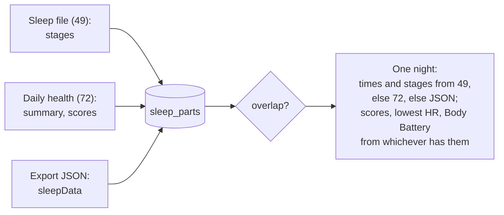

# The data goarmin reads

What goarmin takes from a watch's FIT files and from a Garmin Connect export, where each piece
shows up, and the rules it uses when two sources describe the same thing. How files arrive is
in [architecture.md](architecture.md).

Every stored file stays readable even where no table uses it yet: **Devices › Files** opens any
FIT file in the inspector, with every message and field named after the FIT profile (the
official one plus the community's names for undocumented messages, `pkg/fitprofile`).

## FIT files from the watch

FIT files have a type in their header. goarmin reads these:

| FIT type | File | What goarmin takes | Shown in |
|---|---|---|---|
| 4 | Activity | Sessions (one activity each, multisport split), laps, the 1-second track, time in zones, training effects, the workout it followed | Training › Activities, Calendar |
| 20 | Activity summary | Sessions without a track (activities another device recorded) | Training › Activities |
| 32 | Monitoring | Heart rate, steps, distance, calories, active time, intensity minutes, ascent, stress, Body Battery, respiration, SpO2 | Health, At a glance |
| 49 | Sleep | The night's stages (end-marked levels), scores, the sleep insight | Health › Sleep |
| 68 | HRV status | Overnight 5-minute HRV, last night, the balanced range | Health › HRV |
| 72 | Daily health | Each night's summary (about 100 nights back), 28 nights of HRV, naps, daily altitude, max and minimum heart rate | Health › Sleep, HRV |
| 44 | Metrics | VO2 max, training readiness, acute and chronic load, training status, race predictions, endurance and hill score, recovery time, thresholds, acclimation | Training › Performance |
| 77 | Garmin Coach | The suggested workout for each day | Training › Coach |
| 9 | Weight | Weigh-ins from a scale: weight, body fat, water, bone and muscle mass, BMI, metabolic age | Health › Body |
| 73 | Skin temperature | Overnight deviation from the baseline, raw and per night | Health › Body |
| 79 | Sleep disruption | Disruption periods and the night's severity | Health › Sleep |
| 61 | ECG | Recordings with the watch's classification, heart rate, RMSSD and the waveform | Health › Heart |
| 74 | Physiology backup | VO2 max, lactate threshold, FTP, max heart rate snapshots | Training › Performance |
| 2 | Settings | Clock, units, resting heart rate, sleep window, step lengths, zones, bikes | Devices › a watch › Settings |
| 3 | Sport profiles | Each profile's heart rate zones | Zones in activities |
| 5 | Workouts | Steps, repeats, targets, exercises (category and number, which pick each exercise's [3D figure](figures.md)) | Training › Workouts |
| 6 | Courses | Track, course points, laps | Training › Courses |
| 10 | Totals | Lifetime time, distance, calories and sessions per sport | Activities, Performance |
| 11 | Goals | Step, floor and intensity goals | Preferences defaults |
| 29 | Records | Personal records | Training › Records |
| 87 | Gear | Shoes and bikes | Training › Gear |
| 37 | Golf clubs | Clubs | Account data |
| 41 | Settings change log | Which setting changed when, named | Devices › a watch |
| 58 | Device data | Solar charging | Devices › a watch |
| 1, 33 | Device, multisport | Kept as documents | Devices › a watch |

The daily-health and monitoring readers are message-driven: they read the messages they know in
whichever file carries them. A physiology message inside an activity file counts too.

## The Garmin Connect export

Garmin's data export is a zip of zips. goarmin recognises it by its `DI_CONNECT/` folder and:

- **stores every FIT file** inside (usually the bulk: years of uploads from every device) and
  ingests it like a watch's own file;
- **keeps every other file** (JSON, CSV, GPX, images) as a raw file and reads the ones it knows:

| Export files | Become |
|---|---|
| Daily summaries (UDS) | Steps, distance, calories, floors, intensity minutes, heart rate, stress, Body Battery, respiration per day; a day summary where the watch's own files are missing |
| Sleep data | Night parts (merged with the watch's nights) and naps |
| Training readiness, acute load, training history, max met (VO2 max), race predictions, endurance, hill score, heat and altitude acclimation, running tolerance, cycling ability | Daily values for Training › Performance |
| Health status | Overnight metrics against their baselines (Health › HRV) |
| Biometrics, fitness age, nutrition | Weigh-ins (where the scale's files lack them), VO2 max, thresholds, fitness age, calorie goal |
| Hydration | Drinks per day (Health › Body) |
| Health snapshots | Snapshot summaries |
| Summarized activities | Extra fields on the watch's activities, or activities of their own until a FIT file replaces them |
| Gear, personal records, ECG | Training › Gear and Records; ECGs the watch's files lack |
| Workouts | The account's Garmin Connect workouts in the workout library (Training › Workouts): sports as a watch writes them, steps flattened, exercises by their FIT numbers |
| Profile, settings, goals, workouts, courses, golf clubs, device registrations, orders, consents, social data, Connect IQ, LiveTrack, inReach, media | Account documents (Settings › Account data) |

## When two sources disagree

- **The watch wins.** A day's value from a watch's FIT file outranks the export's JSON value for
  the same day (`daily_values.rank`: FIT 2, export 1; then the newer one). JSON fills only what
  FIT lacks.
- **Copies collapse.** The same FIT file arriving over Bluetooth, from USB and inside the export
  is stored once (sha256, then FIT identity).
- **One night per sleep.** Several files describe the same night: the sleep file with stages,
  the daily-health summary, the export's JSON. Each is kept as a part; parts that overlap are
  one night.

## The workout library

Training › Workouts lists every workout goarmin keeps, once each, whether a watch has it now
or not:

- **Versions.** A watch's workout file and Garmin Connect's list (from the export) can hold the
  same workout. Versions with the same name (case and spacing aside) and sport are one workout;
  the page shows a watch's version, which is what the watch runs, and says where the others came
  from.
- **The Connect format.** Connect's step types become intensities (interval → active), its
  repeat groups become a watch's repeat steps, its exercise names their FIT numbers. Checked on
  a real export: the seven workouts that were also on the Fenix 8 come out step for step the
  same as the watch's files. An AMRAP (Connect's "iterations" in milliseconds) becomes a repeat
  for a time.
- **On the watch or not.** At the end of each sync the watch lists every workout it keeps
  (synced or not, read-only), and the server records the list per watch. A workout is *on* a
  watch while it is listed, and *removed* once it no longer is (deleted on the watch, or by
  Garmin Connect). A workout file is stored under its item's id (`<uid>.fit`), so a listed item
  finds its workout; the same bytes sent to the watch again under a new item find it too.
- **Sent to a watch.** A workout switched on for a watch goes to it at the next sync, pushed as
  Garmin Connect does ([protocol 08](protocol/08-workout-transfer.md)): a watch's own file as
  its bytes, a rename or Garmin Connect's version written as a workout file (a description over
  FIT's 255 bytes is cut). The watch names the new item, so the library shows the workout on it
  at once; the next sync pulls the file back, the same bytes. `workout_targets` holds the
  switches, `watch_sends` what was sent and the watch's answer.
- **Made, edited or renamed in goarmin.** The editor's work and a rename are goarmin's own
  version of the workout (origin `goarmin`, no file), one per workout, shown in place of the
  others; the originals stay, and *Back to the original* drops it. A workout made in goarmin has
  that version only, and deleting it removes it from the library. The workout stays one entry
  (`workouts.entry_key`), also when the watch later hands back a file under the new name.
- **Which version a watch has.** A watch has the current version of a workout goarmin edited
  only once goarmin sent that version and the watch lists it; until then the next sync sends it.
  Other versions the watch still lists are old copies, to delete on the watch.

## Time and days

- All times are stored as Unix seconds (UTC).
- **A day is the wearer's day.** The watch writes its own UTC offset into its files
  (`tz_offsets`); day boundaries, "today" and the daily totals follow it, across travel and
  daylight saving. The account's time zone setting is optional; the watch's clock replies use
  it when it is set.
- **Running totals** (steps, distance, calories, ascent) count from local midnight. A total
  stamped exactly at midnight closes the day before.

## What the watch does not send

Some values exist only on Garmin's servers or in the phone app (hydration logged in the app,
nutrition, challenges, social data). goarmin shows them when they come in an export and doesn't
pretend to have them otherwise.
