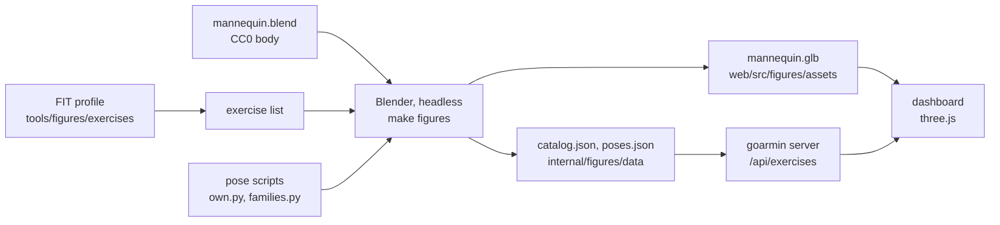

# Exercise figures

Every exercise a Garmin workout can name (1,846 in 51 categories) has a see-through 3D mannequin
that shows it: Training › Exercises in the dashboard, and *View pose* on a workout's steps. This
document is for whoever continues the work: what the figures are made of, how a pose is written,
and how to change one in Blender.



## What you see

- **One mannequin for everything:** the athletic male body of Blender Studio's *Human Base
  Meshes* (CC0), rigid parts hinged at the joints, with its face.
- **The look (decided 2026-11-08): X-ray.**
  - An additive glow with a fill of 0.6, a rim of 3.1 and a rim sharpness of 2.0.
  - The left side in `#8da92e`, the right side in `#c8f542`, the middle in `#aecd3a`.
  - It sits on the card colour `#161b22`.
  - See-through, so a limb behind the body stays visible.
- **Holds and loops:** a hold shows one key pose. A movement loops between two to five key poses
  (0.55 s on each, 0.9 s to blend to the next).
- **Reduced motion:** the figure stands still on a key pose, with a stepper for the others.
- **Where a figure comes from** (`quality`):
  - **own:** posed for that exercise. These are the 45 exercises of the author's workouts.
  - **family:** shared with similar movements. *Dumbbell Lunge* and *Walking Lunge* both use the
    lunge family; equipment is not shown.
  - **category:** the category's figure. No exercise uses this today; it is the fallback.

## The data

| File | What | Size (gzip) |
|---|---|---|
| `web/src/figures/assets/mannequin.glb` | the mesh in its rest pose, no animation, no materials; each node's extras name its part (`goarmin_part`) | 436 KB (121 KB) |
| `internal/figures/data/catalog.json` | every exercise: `key` (category/number), `category`, `category_num`, `number`, `name`, `title`, `quality`, `family`, `pose` (its pose set), `mode` (hold or loop) | 398 KB (47 KB) |
| `internal/figures/data/poses.json` | `parts` (19 names) and `sets`: pose set → key poses | 582 KB (60 KB) |

- **A key pose** is 79 numbers: the root's position (3), then a rotation `[x, y, z, w]` for each
  part in `parts` order.
  - The rotations are local, in glTF axes (Y up), exactly what a glTF node holds: three.js sets
    `node.position` (root only) and `node.quaternion`.
  - Parts not listed (fingers, toes, face) keep their rest transform.
- **Sharing:** 545 pose sets serve the 1,846 exercises, because similar exercises share one.
- **Serving:** the server embeds both JSON files (`internal/figures`) and serves
  `GET /api/exercises` and `GET /api/exercises/{category}/{number}` ([api.md](api.md)).
  - The answers carry an ETag; the data changes only with a new binary.
  - The dashboard draws them in `web/src/figures`. three.js loads in its own chunk with the first
    figure, and a dialog holds the page's only WebGL context while it is open.

## How a pose is written

The pose scripts live in `tools/figures/blender` and run inside Blender (Python is Blender's
scripting language). The world: the figure faces −Y; its left is +X; up is +Z. The vectors are
`F` (forward), `B`, `U`, `D`, `LT` (the figure's left) and `RT`.

**`P(...)` (`fk.py`) builds a pose from joint angles in degrees.**

| Argument | Meaning |
|---|---|
| `orient` | `standing`, `prone` (face down), `supine` (on the back), `side_left`, `side_right`, `inverted`, or an `(up, front)` pair |
| `pelvis`, `spine`, `neck`, `head` | `(flex, bend, twist)`: forward, to the left side, turned to the left. The spine is shared 40 % belly, 60 % chest |
| `arms`, `L`, `R` | `flex` (raise forward), `abd` (raise sideways), `rot` (turn out), `elbow`, `pron`, `wrist` |
| `legs`, `LL`, `RL` | `flex` (thigh forward), `abd`, `rot`, `knee` (bend), `ankle` (toes down; negative pulls them up) |
| `aim` | parts set straight in world terms, after the angles: `{"arm_upper": (D, F)}` (both sides) or `{"hand.L": (F, "medial")}`. The first vector is where the part points, the second where its front faces |
| `contacts` | `("hands", "feet")`: tilt the whole body about x until both groups touch the floor. Also `"y"` for a sideways tilt, and a limit in degrees (default 40). Groups: `hands`, `feet`, `knees`, `forearms`, `head`, `back`, `seat`, each with `.L`/`.R` |

**Use angles for free limbs and aims for supporting ones.** An arm straight down to the floor
under the shoulder stays straight whatever the trunk does. Three examples from `own.py`:

```python
SUPPORT_ARM = {"arm_upper": (D, F), "arm_lower": (D, F), "hand": (F, "medial")}
TOES = {"foot": (D, F)}

# Plank on the forearms: upper arms down, forearms along the floor, on the toes.
P("prone", aim={"arm_upper": (D, F), "arm_lower": (F, "medial"), "hand": (F, "medial"), **TOES},
  contacts=("forearms", "feet"))

# Cat Cow: on all fours, the spine rounds (cat) and arches (cow); two keys loop.
quad(pelvis=(-12, 0, 0), spine=(28, 0, 0), neck=(25, 0, 0), head=(20, 0, 0))
quad(pelvis=(10, 0, 0), spine=(-25, 0, 0), neck=(-25, 0, 0), head=(-15, 0, 0))

# A low lunge, left foot forward, right knee down (the helper sets the contacts).
low_lunge("L", L={"flex": 40, "elbow": 60}, R={"flex": 40, "elbow": 60})
```

**`families.py` adds the helpers the families share:**
- `lw(p, thigh, shin)`: leg angles from world angles, with the foot flat. `p` is the pelvis
  flexion, and thigh and shin are measured forward of straight down.
- Stances: `stand()`, `half_squat()`, `squat_pose()`, `hinge()`, `split_stance()`, `chair()`,
  `kneel()`, `half_kneel()`, `supine()`.
- Arm positions as aims: `DOWN`, `OVERHEAD`, `FORWARD`, `T_ARMS`, `FRONT_RACK`, `BEHIND_HEAD`, …
- `mirror(spec)` swaps left and right, for alternating exercises.
- `lifted(spec, m)` raises a pose off the floor: hanging from a bar, or in the air.
- `V(...)` adds weighted vectors. It has **two spellings**:
  - weights before the vector, `V(F, .5, U)`;
  - vector-weight pairs, `V(F, 1, U, .5)` (the call ends with a number).

  A call ending in a vector is read the first way.

## Which pose an exercise gets

`catalog.build()` gives every exercise its keys, checking these in order:

1. **`own.py`:** `USER["core/51"] = ("Cat Cow", [key, key])` poses one exercise itself; this
   always wins.
2. **`CATEGORY_RULES`:** rules for one category, e.g. `run`, `bike`, `battle_rope`,
   `suspension`.
3. **Named stretches and yoga poses** (`STRETCH_RULES`, `yoga()`, `stretch()`): for `warm_up`,
   `move`, `pose` and names with *stretch*.
4. **`RULES`:** `(category or "", name regex, builder, label)`, first match wins. The specific
   rules come before the general ones: *side plank* before *plank*, *push-up and row* before
   *push-up*, *single-leg deadlift* before *deadlift*.
5. **`CATEGORY_DEFAULT`:** the category's family. Exercises that land here have quality
   `category`.

`weighted_` and `_with_weights` are dropped from a name before matching. Flags read from the name
(`C`) shape a family: seated, kneeling, half kneeling, single leg, single arm, alternating, hold,
wide, close, jump.

**To change how an exercise looks:**
- **Just this one:** add it to `USER` in `own.py`.
- **A whole family** (all lunges, all rows): change the family function in `families.py`.
- **It lands in the wrong family:** add or move a rule in `RULES`. `fig.find("name")` shows where
  an exercise lands today.

## Working in Blender

You need Blender 5.2 LTS (`blender` on the path). The body is in the repository
(`tools/figures/blender/mannequin.blend`, 193 KB; `make figures-asset BUNDLE=…` writes it again
from the original bundle).

1. Start Blender. In the **Scripting** tab, **Open** `tools/figures/blender/session.py` and
   **Run Script** (or start `blender -P tools/figures/blender/session.py`). The script:
   - builds a scene `goarmin-figures` with the mannequin, a camera, a light and a floor, in solid
     lime for reading poses;
   - puts `fig` into the Python console.
2. In the Python console:

   | Command | What it does |
   |---|---|
   | `fig.find("lunge")` | exercises whose name, title or family match |
   | `fig.show("core/51")`, `fig.show("core/51", 1)` | pose an exercise, key by key |
   | `fig.play("core/51")` | put its keys on the timeline; Space plays the loop |
   | `fig.review("core/51")` | render it from ¾ and the side |
   | `fig.sheet(category="plank")` | render many on contact sheets (also `family="lunge"`, `keys=[…]`); needs ImageMagick |
   | `fig.reload()` | read the scripts again after editing them |
   | `fig.export()` | write the app's files, as `make figures` does |

   Renders go to the system's temporary folder (`goarmin-figures`); `FIGURES_REVIEW` picks
   another one.
3. Edit `own.py` or `families.py` in your editor, then `fig.reload()` and `fig.show(...)` again.
   When it looks right, check the whole family on a sheet. Then run `make figures` (or
   `fig.export()`) and look at `git diff`.

## Rebuild and ship

1. `make figures` runs Blender headless (`tools/figures/blender/build.py`).
   - It lists the exercises from the FIT profile (`go run ./tools/figures/exercises`) and poses
     every one.
   - It writes the three files. The output is byte-stable: the same scripts give the same files,
     from `make figures` or from a session.
2. `make check`:
   - `internal/figures` checks that every exercise has a pose set and every rotation is a unit
     quaternion;
   - the API test serves an exercise;
   - the dashboard tests use a mocked canvas (jsdom has no WebGL);
   - a guard keeps three.js to `web/src/figures/FigureCanvas.tsx`.
3. Commit the scripts and the generated files together, then deploy as usual.

## Things learned the hard way

- **Mirrored parts.** The right-side parts are mirrored copies (scale −1). A pose rotates each
  part's whole rest matrix, and a reset restores the stored rest matrix; decomposing and
  normalising breaks the right side.
- **Parent inverse.** Blender keeps a parent-inverse matrix that glTF bakes into each node. The
  export takes rotations relative to the parent's world matrix, not `rotation_quaternion`.
- **Supports.** Supporting limbs need aims, not angles: angles turn with the trunk, and the hands
  or knees float.
- **Contacts.** A contact tilt beyond about 15° makes a standing pose lean. Lunges and stances
  limit it, and the back leg of a lunge is long enough to reach the floor (about 55° back).
- **Seated legs.** In `seated()` the legs follow the pelvis: a forward fold adds its pelvis
  flexion to the hips, so the legs stay on the floor.
- **Review renders.** Workbench is twice as fast as EEVEE and reads poses well enough. A floor
  plane shows contact and lift.
- **Tests and the clock.** Week views start on Monday: fixtures for "the last three days" left
  the week on Mondays and Tuesdays. Series spanning "six hours ago" fell into yesterday after
  midnight. Fixtures anchor to a past week, and to today in the account's zone.

## Credits

- **Human Base Meshes** v1.4.1 by Blender Studio, CC0 1.0: public domain, credit appreciated.
  `tools/figures/blender/mannequin.blend` holds one of its bodies.
- **three.js** (MIT) draws the figure in the dashboard.
