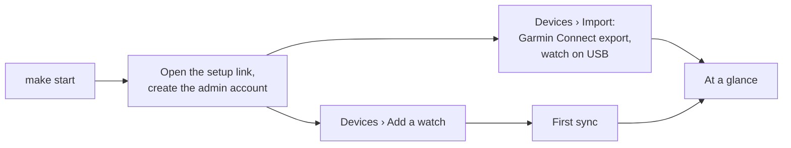

# Getting started

From a fresh checkout to your own data in the dashboard: install, create the first account, add
your watch, bring in your history. This runs everything on one Linux computer near the watch;
[running.md](running.md) covers a server elsewhere.



## 1. What you need

- **Linux with BlueZ** and a Bluetooth LE adapter. goarmin talks to BlueZ over D-Bus as your
  user; a desktop session has the rights, no root needed.
- **Go 1.27.3**, **Node.js 26** and **npm**, to build.
- **sqlite3** for restoring backups and the inspection targets, and **GNU time** for
  `make bench-import`.

`make check-tools` says what is missing.

**The watch:** goarmin is tested with a Garmin Fenix 8. Other recent Garmin watches that sync
the same way (Garmin's FileAccess sync) should work but are untested. Imports read FIT files from
any Garmin device.

## 2. Build and start

```sh
git clone https://github.com/karamble/goarmin.git
cd goarmin
make web-deps    # once: the dashboard's npm packages
make start       # build, then start the server with the sync role on http://localhost:8642
make logs        # the first start prints the setup link
```

The log shows a line like:

```
First run: create the admin account at
  http://localhost:8642/setup?token=…
```

Open it and create your account: e-mail, name and password. You can add a passkey right
after, under **Settings › Security**. The first account is the admin; others join by
invitation (**Settings › People**).

`make stop`, `make status`, `make logs` and `make help` do what they say. The data lives in
`~/.local/share/goarmin`.

## 3. Add your watch

Open **Devices › Add a watch** and follow the steps:

1. **Prepare.** Bluetooth on, the watch close by. Put the watch in pairing mode; on a Fenix 8:
   hold the middle-left button › Watch Settings › Connectivity › Phone › Pair Phone. Your phone
   can stay paired with the watch.
2. **Find.** Pick your watch from the list.
3. **Confirm.** The watch and the page show the same six-digit code. Confirm on both.
4. **Set up.** Give it a name and answer one question: *does Garmin Connect on a phone still
   sync this watch?*
   - **Yes:** goarmin leaves the files on the watch so the phone can still fetch them.
     Whichever app syncs first makes the watch delete its health files.
   - **No:** goarmin marks files as synced, as Garmin Connect does, and the watch can free
     them.

   You can change this later in the watch's **Settings**.
5. **First sync.** goarmin fetches what the watch has. After that it syncs every 30 minutes and
   whenever you press **Sync now**.

On the command line, `goarmin pair` does the same in a terminal.

## 4. Bring in your history

The watch only holds recent days. Your full history comes from Garmin:

- **The Garmin Connect export.** Request your data export in your Garmin account's data
  management page; Garmin e-mails a download link, usually within days. Upload the zip under
  **Devices › Import › From files**. goarmin imports every FIT file in it (years of activities,
  sleep and daily data, from every device you had) and reads the export's own files: daily
  summaries, readiness, VO2 max, weigh-ins, hydration, records, gear and more. A typical export
  imports in about a minute, with a progress panel while it runs. Importing it again changes
  nothing.
- **The watch on USB.** Plug it in with its cable. **Devices › Import** lists it, and with
  *Import when plugged in* (the default) goarmin reads it by itself, without changing anything
  on the watch. It finds files the watch never offers over Bluetooth.
- **Files.** Any FIT files, a folder (a copy of the watch's `GARMIN` folder) or a zip of them,
  also under **Devices › Import**, or `goarmin import -user you@example.com PATH`.

Devices you had before (an older watch, a scale) show up under **Devices** with the data they
brought.

## 5. Next

- [user-guide.md](user-guide.md): what each page shows.
- [running.md](running.md): backups, updates, a server with HTTPS, Docker.
- **Map tiles.** Routes are drawn without a map until you set a tile server
  (`GOARMIN_TILE_URL`, see [running.md](running.md#configuration)).
