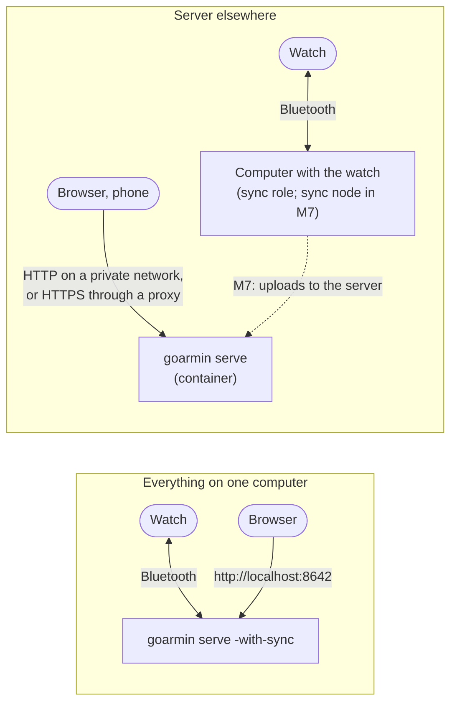
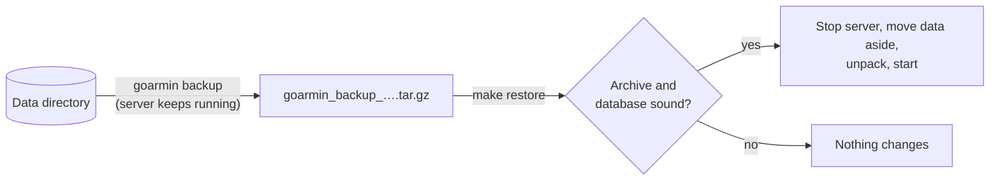

# Running goarmin

How to run goarmin day to day: on one computer or with the server elsewhere. Also backups,
updates, moving to a server, and every setting. First steps are in
[getting-started.md](getting-started.md).

## Two ways to run it

**Everything on one computer.** `make start` runs the server with the sync role on the Linux
computer the watch is paired with. Simplest; the dashboard is at http://localhost:8642, or on
your network behind a reverse proxy.

**The server elsewhere.** The server runs in a container on a home server ([Docker](#docker)),
reachable on your private network or behind a reverse proxy with HTTPS. Until the sync node
exists (planned, M7), the computer near the watch keeps running `make start` with its own data,
and data moves to the server as a copy ([Moving to a server](#moving-to-a-server)).



## On one computer (make)

| Target | What it does |
|---|---|
| `make start` / `stop` / `restart` | Build, then start the server in the background, or stop it. A running sync finishes first; `FORCE=1` kills it after 60 s. |
| `make run` | The same in the foreground |
| `make status` / `logs` / `logs-follow` / `health` | Whether it runs, its log (`~/.local/state/goarmin/serve.log`), whether it answers |
| `make backup` / `backup-list` / `backup-clean` / `restore BACKUP=…` | Backups, below |
| `make info`, `list-users`, `list-watches`, `list-syncs`, `days`, `activities`, `db-shell` | Look at the data (read-only) |
| `make help` | Every target |

`LISTEN`, `DATA` and `SERVE_ARGS` override the defaults (`127.0.0.1:8642`,
`~/.local/share/goarmin`, `-with-sync`), e.g. `make start LISTEN=0.0.0.0:8642`. `make` reads
settings from a `.env` file in the checkout (git-ignored), such as the map tile settings.

goarmin doesn't install itself as a service. After a reboot, `make start` again.

## Docker

`docker/` runs the server alone: [docker/README.md](../docker/README.md) has the details.

```sh
cd docker
export GOARMIN_VERSION=$(git describe --tags --always --dirty)
docker compose --env-file ~/.config/goarmin/compose.env up -d --build
```

- **The image:** Alpine with the time zone database and GNU time, a static binary, non-root
  (uid 10001), a read-only root, and a health check.
- **The compose file publishes no port;** your reverse proxy reaches `goarmin:8642` on the
  compose network.
- `make docker-dev-up` tries the image on a scratch copy of your data at
  http://localhost:18642.

## Reaching it from other devices

Set `GOARMIN_PUBLIC_URL` to the address people open. It can be plain HTTP or HTTPS:

- **Plain HTTP on a private network** (your LAN, a VPN or mesh) is fine with passwords:
  `GOARMIN_PUBLIC_URL=http://goarmin.example:8642`. Publish port 8642 directly (in Docker, a
  `ports:` entry in your own override file). Browsers allow passkeys only on HTTPS and
  `localhost`, so on plain HTTP everyone signs in with a password, and session cookies aren't
  marked Secure.
- **HTTPS**, for passkeys or anything beyond a private network: put a reverse proxy with TLS
  in front.

### HTTPS and passkeys

```sh
GOARMIN_PUBLIC_URL=https://goarmin.example:8642
```

- **Passkeys are bound to that host name.** Passkeys made on another address (e.g. `localhost`)
  don't work on the new one: sign in with the password and add a passkey again.
- `https` makes the session cookie Secure.
- **The proxy must pass the `Host` header through.** Writes are accepted from the public URL's
  host or the request's own host.
- goarmin trusts no forwarding headers, so every request seems to come from the proxy. The
  per-address sign-in limit then counts everyone together.

A minimal Caddy setup with its own certificate authority (install its root certificate on your
devices), in front of the compose network:

```
goarmin.example:8642 {
	tls internal
	reverse_proxy goarmin:8642
}
```

## Backups

`goarmin backup` writes one archive while the server runs:
- a consistent snapshot of the database (SQLite's `VACUUM INTO`, integrity-checked);
- the raw files;
- the watch spool.

Raw files never change and are stored before the database refers to them, so the snapshot and
the files always agree.

```sh
make backup                                           # → ~/goarmin-backups/goarmin_backup_YYYYMMDD_HHMMSS.tar.gz
goarmin backup -out /backup -keep-days 7 -keep-min 3  # nightly, pruning old archives
make backup-list
make backup-clean                                     # older than 30 days, keeping the newest 3
```

`make restore BACKUP=goarmin_backup_….tar.gz` works like this:
- it checks the archive and stops the server;
- it moves the current data aside (not deleted);
- it unpacks the backup, checks its database, and starts the server again.



Keep a copy somewhere else: the archive holds all your health data, so treat it like the data
itself.

## Updating

```sh
git pull
make backup
make restart          # or, in Docker: docker compose … up -d --build
```

The database migrates itself at start. Migrations only add, and an older program refuses a newer
database.

## Moving to a server

The copy is exact: accounts, settings, devices and their owners, history.

1. On the old computer: `make backup` (the server keeps running).
2. On the server, with goarmin stopped, unpack the database and the raw files into the data
   directory:

   ```sh
   tar -xzf goarmin_backup_….tar.gz --strip-components=1 -C "$DATA" --wildcards '*/goarmin.db' '*/raw'
   ```

   Leave out `watches/` and `node.json`: they belong to the computer that syncs the watch.
3. Start it, sign in with your password, add a passkey for the new address.

From then on the two copies differ until the sync node (M7) lets the watch's computer feed the
server.

## Monitoring

- **`GET /healthz`** answers `ok` without a session and without touching the database, and
  isn't logged.
- **`goarmin healthcheck`** asks it on the same machine. The container's health check uses it.
- **Logs:** one line per event, no tokens or personal data, on standard error (`make logs`, or
  the container's output).

## Configuration

Every setting is a flag of the command and an environment variable. `goarmin <command> -h`
lists the flags with their defaults.

| Variable | Commands | Meaning |
|---|---|---|
| `GOARMIN_DATA_DIR` | all | The data directory (default `~/.local/share/goarmin`; `/data` in the image) |
| `GOARMIN_LISTEN` | serve, healthcheck | Address to listen on (default `127.0.0.1:8642`; `0.0.0.0:8642` in the image) |
| `GOARMIN_PUBLIC_URL` | serve | The address people open; sets the passkey host and the origin (default `http://localhost:<port>`) |
| `GOARMIN_TILE_URL` | serve | Map tiles: a preset (`jawg-matrix`, `jawg-dark`) or a template with `{z}`, `{x}`, `{y}`, optionally `{s}` and `{token}`. Empty: routes without a map. OpenStreetMap's own servers are refused (they require an identifying User-Agent). |
| `GOARMIN_TILE_TOKEN` | serve | The token for `{token}`; never logged |
| `GOARMIN_TILE_DARK`, `GOARMIN_TILE_ATTRIBUTION` | serve | For a style that isn't a preset: already dark or not, and its credit line |
| `GOARMIN_IMPORT_MAX_GB` | serve | The largest upload (8) |
| `GOARMIN_ADAPTER` | serve, pair, sync, probe, live | The Bluetooth adapter (`hci0`) |
| `GOARMIN_DEVICE` | sync, probe, live | The watch's address, when there is more than one |
| `GOARMIN_FEATURES` | serve | `0` stops goarmin from telling the watch which features it supports |
| `GOARMIN_FIRST_SESSION` | serve | `1` sends the first-session events after a fresh pairing (untested) |
| `GOARMIN_USER` | import, days, activities | The account's e-mail |
| `GOARMIN_BACKUP_DIR` | backup | Where archives go (default `~/goarmin-backups`; `/backup` in the image) |

The main flags of `serve`:

| Flag | Meaning |
|---|---|
| `-with-sync` | Also run the sync role: scheduled syncs, live values, pairing |
| `-sync-interval 30m` | Time between scheduled syncs |
| `-no-usb` | Don't look for watches plugged in by USB |
| `-v` | Log request errors in detail |
| `-fake-pairer` | Development only: made-up watches for trying *Add a watch* (scratch data only) |

## Commands

| Command | What it does |
|---|---|
| `serve` | The server (with `-with-sync`, the sync role too) |
| `pair` | Pair and identify a watch in a terminal |
| `sync -once` | One sync (`-no-archive` keeps files on the watch, `-include-synced` also fetches what another app took) |
| `probe` | Connect and handshake only, print what the watch reports |
| `live` | Stream live values in the terminal |
| `import -user EMAIL PATH…` | Import files, folders, zips, the export; `-usb` reads a watch on USB |
| `usb` | List watches on USB; `-copy DIR` copies the `GARMIN` folder (read-only) |
| `reingest` | Extract the stored files again (`-all` for every file) |
| `backup` | Write a backup archive |
| `user` | List accounts; `-email E -set-password < file` sets a password from standard input |
| `days`, `activities` | Print an account's daily summaries or activities |
| `healthcheck` | Exit 0 if the server here answers `/healthz` |
| `version` | Print the version |

The CLI and the server share locks: a command that needs Bluetooth or USB waits for, or refuses
during, the server's own use.
