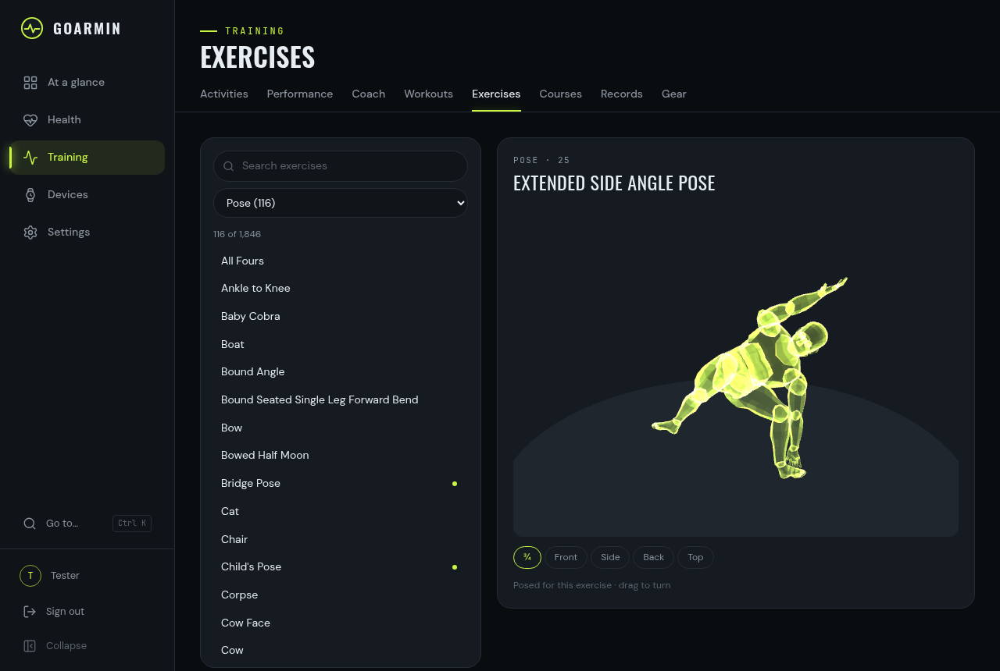
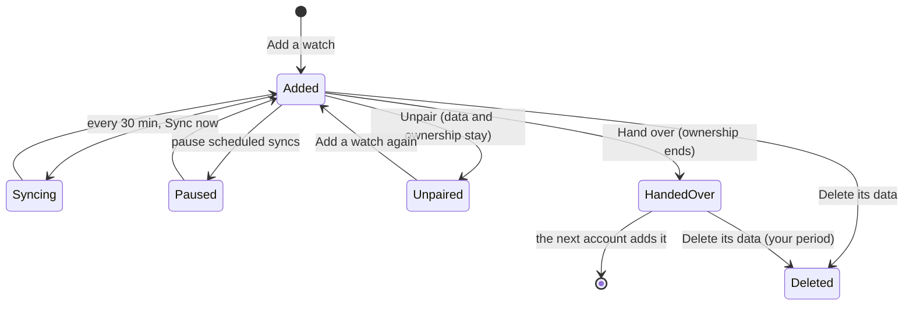

# User guide

The dashboard, section by section. Everyone sees only their own data; admins manage accounts
but see no one else's health data either.

## Moving around

- **The rail** on the left (a bottom bar on phones) holds the sections: At a glance, Health,
  Training, Live, Devices, Settings. Each section has tabs under its title.
- **The date navigator** (top right) picks the day and the period (day, week, month, year) where
  a page has periods.
  - Keys: ← and → step the period; T jumps to today; D, W, M and Y switch the period.
  - The date stays in the address, so a link opens the same view.
- **Ctrl/⌘-K** opens the palette: pages, actions (sync a watch, go live, customize the glance,
  sign out), "go to" a date ("yesterday", "3 days ago", "2026-10-03"), and your recent
  activities, workouts and courses.
- In week, month and year views, click a day (a bar, a dot, a calendar cell) to open it.
- **About** (under *Go to…* in the rail; in *More* on phones) shows the version, the link to the
  source code and the disclaimer of liability: use at your own risk, no medical advice (the
  data's accuracy is not guaranteed), and the exercise figures are simplified illustrations.

## At a glance

A board of cards you arrange yourself.

- **Customize** (or the palette) to rearrange: drag to reorder (mouse, touch or keyboard),
  pick a size (S, M, L, wide), set options, remove (with undo), add from the catalog.
- **Cards:**
  - health: Body Battery, Sleep, HRV, Your day (heart rate, stress, Body Battery and sleep on
    one timeline), Steps, Resting HR, Stress, Breathing, Intensity minutes;
  - body: Weight, Skin temperature, Hydration;
  - training: Training readiness, VO2 max, Recent activities, Last route, Garmin Coach,
    Workout for today, Lifetime;
  - Trend (any daily value over 14 days to a year);
  - devices: Live heart rate, Watch.
- The layout is saved to your account, so it follows you to another browser.
- **Getting started** guides a new account (passkey, a watch or an import, the first sync, preferences) until every step is done or you hide it.

## Calendar

The days by month (or by week, as an agenda), with what you recorded and what you planned.

- **A day's bars:** one short bar per kind of data, in goarmin's colours: activities (lime, one
  each), planned workouts (hatched: Garmin Coach's and your own, ✓ once done, faint when missed),
  steps and floors (faint below their goals), sleep, HRV and naps (cyan), heart rate and ECG
  (pink), stress and Body Battery (amber), weigh-ins and drinks (grey). On a wide screen a day
  names its activities and plans and gives each bar its number ("Sleep 79", "7,305 steps",
  "9 floors"); "+n" counts what doesn't fit.
- **Show** in the header hides kinds you don't want; the choice is saved to your account.
- **A day** opens beside the month (a sheet on a phone): its timeline (heart rate, stress, Body
  Battery, sleep and activities), what was planned, its activities, and a line per value
  recorded (steps against the goal, floors climbed against theirs and floors down, sleep and
  sleep need, HRV, heart rate, stress, Body Battery charged and drained, breathing, intensity
  minutes, calories, weight, drinks, ECG, naps), each opening its page for that day. ◀ ▶ move
  day by day; arrow keys move through the grid.
- **Your own plans:** *Plan a workout* on a day (or *Plan* on a workout's page, or the palette)
  puts a workout of your library on a day. A plan counts as done when you record an activity
  that day that followed that workout (else one of its sport); it is missed once the day is past.
  Drag a plan to another day on a wide screen, or use *Move to…*; *Remove* has an Undo. Plans are
  kept in goarmin; sending them to the watch comes later.
- The calendar looks ahead two years, for plans; Garmin Coach's week ahead shows there too.

## Health

Every tab has day, week, month and year views. Each chart has a table view (**Table**) with
the same numbers.

| Tab | Day | Week, month, year |
|---|---|---|
| **Sleep** | Score and its parts, time asleep against your sleep need, bed and wake times, lowest heart rate, Body Battery gained, the stages (hypnogram) with the night's heart rate, HRV, breathing, stress and Body Battery, naps | Stages per night with the score, bed and wake times, a year calendar of scores |
| **HRV** | Last night against your balanced range, weekly average, the night's 5-minute values, Garmin Connect's health status | Nightly values against the baseline band |
| **Heart** | All-day heart rate with its range, resting heart rate, activities shaded; ECG recordings with their waveform | Daily ranges with resting heart rate |
| **Energy** (Stress & Body Battery) | Body Battery and stress on one axis, charged and drained, time in each stress level | Daily ranges, a calendar of stress |
| **Breathing** | Respiration and overnight SpO2 | Daily averages |
| **Movement** | Steps and floors against their goals, both by the hour; distance, ascent (with the floors down), active calories, intensity minutes | Daily steps and floors against their goals, and the days each goal was reached; for a year, a calendar of each |
| **Body** | The last weigh-in (weight, body fat, BMI, muscle, bone, water), skin temperature, hydration, fitness age | Weight and body fat over time, nightly skin temperature, hydration |

## Training

- **Activities.** All your activities with route thumbnails, or a table, filtered by sport.
  Period views add totals per sport.
  - An activity shows its numbers; a map coloured by heart rate, pace or elevation; and linked
    charts (pace or speed, heart rate in zones, elevation, cadence, power, temperature) on a
    time or distance axis.
  - Pointing at a chart moves a dot along the route, and pointing at the route moves the charts.
  - Also: laps, splits per km or mile, time in heart-rate zones (the watch's own when it
    recorded them) and the FIT file to download. ← and → go to the previous and next activity.
- **Performance.** Training status, readiness, acute against chronic load, VO2 max, race
  predictions, endurance and hill score, recovery time, acclimation, running tolerance, cycling
  ability; *All* shows every year you have.
- **Coach.** Garmin Coach's plan for the week, with what you did ticked off.
- **Workouts** and **Courses.**
  - Workouts is your **workout library**: every workout goarmin keeps, from the watch and from
    your Garmin Connect export (Devices › Import), once each, kept also after it leaves the
    watch.
    - Each card says, per watch, whether the watch has it now (*On*), had it and no longer does
      (*Removed*), or never had it. The line on top counts what each watch holds and when the
      last sync checked.
    - Search by name or sport, and filter by sport, source and *On ‹watch›* or *On no watch*.
      The filters stay in the address, so a view can be bookmarked.
    - **On your watches** has a switch per watch. Switched on, the watch gets the workout at its
      next sync, which starts at once (with the watch near the computer that syncs it). A
      switch is on for what a watch has. Switched off, goarmin sends it no more, but it cannot
      delete from a watch: the page says to delete it on the watch (Workouts › the workout ›
      Delete), and notices when it is gone. A workout you delete on the watch is not sent again
      until you switch it on again.
    - **New workout** opens the builder; **Edit** on a workout's page changes it in place, and
      **Duplicate** makes a copy to change ("‹name› 2").
      - The steps are a list: drag a step by its grip (on a phone, hold it first), or focus it
        and press Alt+↑ and Alt+↓. ↑ and ↓ select, Enter opens a step, Delete removes it,
        Ctrl+D duplicates it, Ctrl+Z and Ctrl+Shift+Z undo and redo, Ctrl+S saves.
      - **Add** after the selected step: an exercise (the picker searches all 1,846, shows the
        3D figure, and keeps picking with Shift+Enter), a rest, a warm-up, a cool-down, an
        interval, or a repeat (around the steps you Shift-clicked, or empty).
      - **The panel beside the list** (a sheet on a phone) sets the selected step up:
        - an exercise: its figure, reps, time or the Lap button, weight, intensity and notes;
        - **sets:** "3 sets × 12 reps, rest 1:00", which goarmin writes as Garmin does;
        - a rest or an interval: time, distance, Lap, calories, or until a heart rate or power;
          a target of heart rate (zone or range), pace, power or cadence;
        - a repeat: a number of times, or as many rounds as fit in a time.
      - A repeat holds single steps, as in Garmin's own workouts; sets are repeats themselves.
      - The summary shows about how long it takes, the exercises, the intensity strip and
        "FIT steps n of 100" (a watch takes 100; sets count three). What a watch would not take
        is listed, and Save stays off until it is fixed.
      - Leaving with unsaved changes asks first; a draft stays in the browser and is offered
        back.
      - A workout on a watch that you change goes again at the next sync. The watch keeps the
        old version too (it takes no deletes), and the page says which one to delete there.
    - **Hide** (⋯ on a workout's page) takes a workout out of the library; it shows again while
      a watch has it. The switch on each card puts a workout on a watch or takes it off.
    - **Rename** gives a workout another name or description (Garmin Connect's copies start
      with "Copy of"). goarmin keeps it as its own version and keeps the original too: *Back to
      the original* undoes it.
    - A workout shows its steps, repeats and targets. A step with an exercise has **View pose**:
      a 3D figure of the movement in a dialog that steps through the workout's exercises
      (Previous and Next, or ← and →).
  - Courses: route, elevation profile, course points and the FIT file.
- **Exercises.** Every exercise a Garmin workout can name (1,846), by category, with a search.
  - Pick one to see its figure: a see-through mannequin that holds the pose or moves through it.
  - Drag to turn it, or use ¾, Front, Side, Back and Top.
  - *Posed for this exercise* marks a figure made for that exercise. *Shared with similar
    movements* means it shows the movement without the equipment (a dumbbell lunge looks like a
    lunge).
  - With reduced motion on, the figure stands still and arrows step through its key poses.
  - How the figures are made: [figures.md](figures.md).

  
- **Records** and **Gear.**
  - Records: your personal records, linked to their activities.
  - Gear: shoes and bikes, with the distance used against their limit.

## Live

Opens a live link to your watch: heart rate, stress, Body Battery, breathing, steps, calories,
floors and HRV from beat intervals (when the watch sends them), on 10-minute charts.

- The link takes about 10 seconds to open.
- It pauses when the tab is hidden for 2 minutes and ends after 30 minutes, so the watch can
  sync; *Keep going* continues.
- Live needs the sync role (`goarmin serve -with-sync`).

## Devices

- **Devices.** Your watches, scales and other devices, grouped by kind.
  - A watch shows its battery, last and next sync, and progress while a sync runs. **Sync now**
    fetches at once.
  - A scale or a device known only from imports shows what came from it.
  - Devices you no longer have stay listed under their period, with their data.
- **A watch's page:**
  - **Overview:** status, what came from it, recent syncs.
  - **Files:** what goarmin fetched, with its state on the watch. Activities can be deleted from
    the watch.
  - **Settings:** name, after fetching, scheduled syncs on or paused, import when plugged in
    by USB, and what the watch itself is set to (clock, units, zones, gear, solar charging,
    settings history).
  - **Remove:**
    - *Unpair* removes the Bluetooth pairing and keeps everything.
    - *Hand over* ends your ownership; whoever adds it next owns it from then on.
    - *Delete its data* asks you to type the name first, and offers the raw files as a zip
      beforehand.
- **Sync log.** Every sync with its result. Failures explain what to do; "not in range" is not a
  failure.
- **Import.** A watch on USB, file uploads (files, a folder, zips, the Garmin Connect export), and
  the history of imports with what each brought.
- **Files.** Every stored file. **Inspect** shows its messages and fields by name, readable even
  where no page uses them yet.
- **Add a watch.** The pairing wizard ([getting-started.md](getting-started.md#3-add-your-watch)).

## Settings

- **Profile.** Name, time zone, units, and preferences: week start, 12 or 24-hour clock, weekly
  intensity goal, heart-rate zones. Each says "as the watch" until you set your own.
- **Security.** Password, passkeys, signed-in sessions.
- **Account data.** What the Garmin Connect export held about your account (profile, settings,
  goals, device registrations and more), readable.
- **MCP.** Tokens for AI assistants such as Claude, so they can read your data and, if the
  token allows it, act for you ([mcp.md](mcp.md)):
  - the endpoint to give the assistant, with Copy;
  - **New token:** a name, the access (Read; Read and write; Admin for admins) and when it
    expires. The token is shown once, with ready snippets for Claude Code, other clients and
    the stdio bridge;
  - your tokens, with when each was used and how often in the last day; Rename and Revoke;
  - recent calls (the tool, never what was sent), kept 30 days;
  - everything MCP offers, by area, for each access level.
- **People** (admins). Accounts and invitations, every device on the server with its owner and
  sync state. Admins can release a device or add a watch for someone else, but never see their
  health data.
